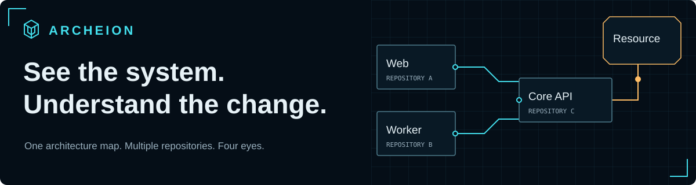
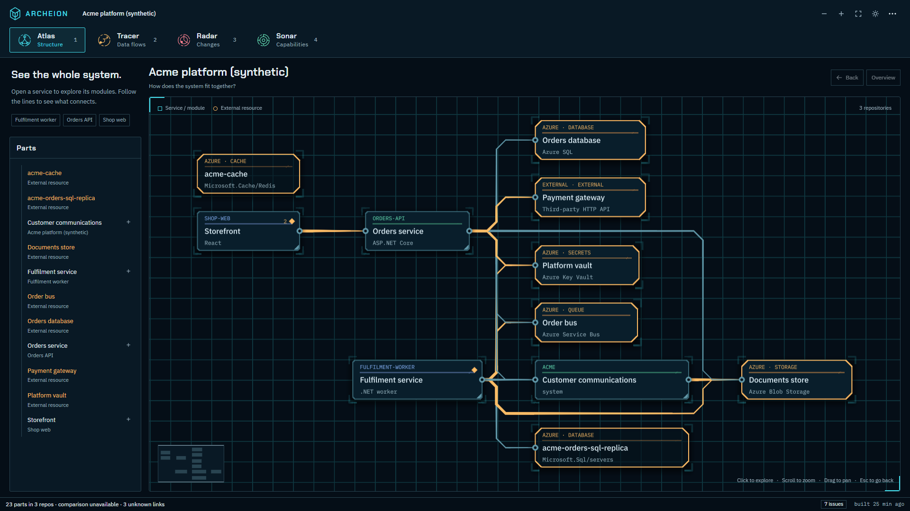
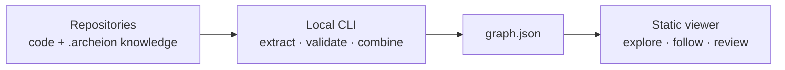

<p align="center">
  
</p>

<p align="center"><strong>An architecture explorer for people building with coding agents.</strong></p>

<p align="center">
  <a href="https://github.com/EduardMelu/Archeion/actions/workflows/ci.yml"></a>
  
  <a href="LICENSE"></a>
  
</p>

<p align="center">
  <a href="#quick-start">Try the map</a> ·
  <a href="docs/AGENT-ONBOARDING.md">Connect your repositories</a> ·
  <a href="CONTRIBUTING.md">Contribute</a>
</p>

When several agents change a project, you need to understand how their work fits into the whole system. Archeion turns small, versioned architecture notes and supported code evidence into a map you can explore across repositories.

Zoom into responsibilities. Follow a prepared data flow. Inspect a dependency change. Find an existing module before building another.



*This example is synthetic. The map explains intended architecture, not live traffic.*

## Four eyes. One stable map.

| Eye | What it helps you answer |
| --- | --- |
| **Atlas** — structure | How do applications, modules, repositories, and external resources fit together? |
| **Tracer** — flows | Where does this request or data go? Follow a prepared route with playback and step controls. |
| **Radar** — changes | What changed against the displayed Git baseline, including local work? |
| **Sonar** — reuse | What already provides this capability? Browse purpose and reuse notes, or filter by keywords. |

Each eye changes the visual treatment while preserving the learned map. Repository labels identify source locations; architectural responsibilities can span repository boundaries.

## Quick start

Requires **Node.js 24**, **npm**, **Git**, and a browser with **WebGL2**. Analyzed C# projects do not need a .NET runtime.

```sh
git clone https://github.com/EduardMelu/Archeion.git
cd Archeion
npm ci
npm run build
npm run archeion -- view -C fixtures/platform
```

This opens a synthetic platform with three repositories, shared Azure resources, reusable capabilities, and prepared flows. Its repos have no Git history, so Radar explains that comparison is unavailable.

To explore Archeion itself, run `npm run archeion -- view`. In PowerShell, use `npm.cmd` if execution policy blocks the `npm` launcher.

## Bring your own system



1. **Knowledge folders:** small Markdown files describe responsibilities, connections, flows, and reuse guidance. Review and commit them with the code.
2. **CLI:** combines connected repositories and supported code evidence into one graph.
3. **Viewer:** renders that graph locally. Exploration makes no LLM calls.

For a separate tool installation, build a tarball with `npm pack --workspace archeion`, then follow the [onboarding guide](docs/AGENT-ONBOARDING.md). Version 0.1.0 is not published to the npm registry.

One parent workspace can connect frontend and backend repositories:

```text
my-system/
  .archeion/workspace.yaml
  frontend/.archeion/system.md
  backend/.archeion/system.md
```

```yaml
archeion: 1
id: my-system
name: My system
repos:
  - id: frontend
    path: frontend
  - id: backend
    path: backend
```

Paths are relative to `my-system`. Stable part IDs connect responsibilities across repos. The parent manifest is local connection configuration; each repo owns its knowledge.

**Using a coding agent?** Give it the [agent onboarding instructions](docs/AGENT-ONBOARDING.md): installation, source inspection, knowledge drafting, validation, and a copyable maintenance rule for your repo's `AGENTS.md`.

## Commands and navigation

| Command | Purpose |
| --- | --- |
| `archeion init -C <repo>` | Create a starter knowledge folder, preserving existing files. |
| `archeion check -C <root>` | Validate knowledge and evidence; report positioned diagnostics. |
| `archeion build -C <root>` | Generate the graph and build metadata. |
| `archeion view -C <root>` | Build and open the viewer; add `--watch` to rebuild on changes. |
| `archeion import-trail <file> -C <root>` | Import an exported investigation for review. |

These examples assume the packaged CLI is available as `archeion`; the [installation guide](docs/AGENT-ONBOARDING.md) also shows direct `node` invocation.

Click a part to explore it. **Back**, **Overview**, breadcrumbs, and the minimap keep you oriented. `1`–`4` switch eyes, `/` focuses keyword filtering, `Esc` returns or pauses, `Space` controls flow playback, and `+`, `-`, `0` zoom and fit. The Parts outline provides keyboard access alongside the map.

## What the map can establish

Archeion is an **early preview** with explicit coverage:

- Extractors support selected **C#**, **TypeScript/TSX**, **OpenAPI**, **ARM JSON**, Azure configuration, and dependency-manifest patterns. See the [coverage table](docs/EXTRACTION-COVERAGE.md).
- Other languages can be described through authored knowledge. **Java and Maven extraction are not implemented.**
- Sonar uses prepared descriptions and deterministic keyword matching. It does not provide semantic duplicate detection.
- Tracer explains prepared architecture flows. It does not report observed traffic or cloud health.
- Radar compares displayed Git baselines. A saved “since my last review” system baseline is not implemented.
- Knowledge can become stale. Agents should propose knowledge edits with relevant code changes; the owner reviews both.
- Missing or ambiguous evidence remains visible. A connected part is context to inspect, not proof of behavioral impact.

Builds and exploration need no model calls. Agents may use models separately while drafting knowledge. Target-project builds never run, and the viewer is served on loopback.

## Contributing

Issues, focused fixes, extraction fixtures, and UX feedback are welcome. Start with [CONTRIBUTING.md](CONTRIBUTING.md); coding agents should also read [AGENTS.md](AGENTS.md).

```sh
npm run lint
npm run typecheck
npm test
npm run build
npm run e2e
```

Browser setup, package smoke checks, and GPU measurements are described in the contributor guide. Keep changes small and preserve evidence, uncertainty, accessibility, and map continuity.

| Directory | Responsibility |
| --- | --- |
| `packages/core` | Contracts, knowledge parsing, extraction, comparison, graph assembly |
| `packages/cli` | Commands, filesystem/Git I/O, local hosting, distribution |
| `packages/viewer` | React + Three.js explorer and layout worker |
| `fixtures/platform` | Synthetic multi-repository example |
| `e2e` | Browser behavior, visual regression, and measured performance |
| `.archeion` | Archeion's own architecture knowledge |

## Documentation

[Knowledge format](docs/KNOWLEDGE-FORMAT.md) · [Extraction coverage](docs/EXTRACTION-COVERAGE.md) · [Build design](docs/BUILD-DESIGN.md) · [Specification](docs/SPEC.md) · [Design system](DESIGN.md) · [Verification](reports/ACCEPTANCE.md)

## License

[MIT](LICENSE). Bundled dependencies, fonts, and parser grammars retain their respective licenses; see [third-party notices](THIRD_PARTY_NOTICES.md).
