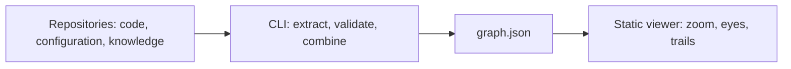

# Archeion POC specification

Archeion is an early preview. TypeScript is used for CLI/core and viewer. Exact schemas are in `packages/core/schema`; the [verification report](../reports/ACCEPTANCE.md) records local checks and limits.

This specification describes the product contract. Implementation coverage and limits are documented separately; a proposed requirement is not a claim that the current preview implements it.

## 1. Problem and audience

Architects struggle to understand how projects connect, which external Azure resources they use, and how data moves through a platform spread across repositories. The knowledge is scattered across code, configuration, deployment definitions, and documentation.

Archeion puts that structure on one explorable map. Architects are the primary audience. Developers use the same map to find implementations, discover existing capabilities, and inspect changes.

The principal questions are:

- How do these projects and resources connect?
- What is inside this application, service, or module?
- Where does this request or data flow go?
- What changed, and what connected parts should I inspect?
- Does something already provide the capability I need?

## 2. Product shape

The product has three pieces:

| Piece | Responsibility |
| --- | --- |
| Knowledge folders | Small Markdown files committed in each repository describe architecture, responsibilities, flows, rules, and reuse. |
| CLI | Runs locally or in CI, reads knowledge and supported code evidence, validates and combines them, and writes one `graph.json`. |
| Static viewer | Reads the generated graph and presents the map. One command starts it locally. |

The graph contains the architecture knowledge needed for exploration. Zoom, eye switching, search, and prepared-flow playback make no LLM calls. Ordinary graph builds also work without fresh LLM calls.

Agents assist with drafting and maintaining committed knowledge. That assistance happens before the viewer consumes the generated graph.

## 3. Domain boundaries

Use the [glossary](../GLOSSARY.md) for product terminology.

- A repository is a code source. A logical system can span several repositories; architectural containment cannot simply equal repository ownership.
- A map part represents a meaningful responsibility or resource. The overview leads into applications/services, then meaningful modules and capabilities. Source files and dependencies are available as evidence on selection.
- Resources and links can be supported by reviewed declarations, extracted facts, or both. Their provenance remains inspectable.
- Shared resource identity needs explicit evidence. Similar names alone are insufficient to merge resources. The exact identity rules are an engineering-design item.
- A flow describes movement through the software. A trail records a person's investigation through map views.

## 4. User stories

1. As an architect, I want a platform overview across repositories so I can understand its major responsibilities and boundaries.
2. As an architect, I want to inspect connections between projects so I can understand their integrations.
3. As an architect, I want external Azure resources on the map so I can see what each project depends on.
4. As an architect, I want to zoom into meaningful internals while retaining context so I can investigate without losing my place.
5. As an architect, I want to switch eyes on the same map so I can examine structure, flows, changes, and reuse.
6. As an architect, I want to follow a prepared cross-project flow with controlled animation so I can understand how requests, messages, or data travel.
7. As a map user, I want hidden matches and changes summarized on visible parents so I can find relevant details from the overview.
8. As an architect, I want source evidence and visible gaps so I can judge what the map establishes.
9. As a developer, I want relevant source and dependency evidence so I can locate an implementation or inspect a technology change.
10. As an architect or developer, I want to find existing capabilities and reuse notes so I can recognize overlap before adding another module.
11. As a developer, I want committed and clearly labeled uncommitted changes in Radar so I can inspect work before committing.
12. As a map user, I want the comparison baseline displayed and changeable so I understand what Radar calls changed.
13. As a knowledge owner, I want an agent-prepared initial draft so I can review architecture knowledge without writing every description myself.
14. As a knowledge owner, I want relevant knowledge edits alongside code changes so I can review both together.
15. As an architect, I want to save and reopen an investigation with notes so I can retain my understanding and identify relevant later changes.
16. As a map user, I want exploration to work from the generated graph so I do not need LLM calls while using the viewer.

## 5. Viewer requirements

### 5.1 Navigation and shared map

Start with an architecture overview appropriate to the selected repository, project, or platform. Support platforms connecting three or more repositories.

Click to zoom from the overview into applications/services and then meaningful modules and capabilities. Keep surrounding context available, make the current location clear, and provide a clear way back. Selection exposes purpose, dependencies, and source evidence.

The retained visual direction is a stable spatial map, cutaway zoom, a quiet resting state, and purposeful animation. Eye changes reveal different information on that map. They must not require newly generated architecture knowledge.

Collapsed Sonar matches and Radar changes produce summaries on visible containing parts. Drilling in reaches the underlying results. Grouping must preserve access to all results and issues.

See the [design system](../DESIGN.md) for visual direction, interaction parameters, and accessibility considerations.

### 5.2 Atlas

Show structure: parts, responsibilities, boundaries, external resources, and connections. It is the entry point for understanding a system and exploring its internals.

The map must support the architect's cross-project and Azure-resource scenario, rather than only representing a repository's folder tree.

### 5.3 Tracer

Play prepared flows through map connections, with hop-by-hop animation, captions, and user control over playback. Flow steps must expose their underlying connections and evidence. Unresolved steps remain visible as gaps.

Prepared playback explains architecture; it does not establish that traffic was observed at runtime. Runtime health and telemetry remain later features.

The references propose a persistent tinted path and parallel token split/merge. These are design proposals. Parallel playback is not an accepted requirement and needs an explicit flow model if adopted.

### 5.4 Radar

Show changes and their connected context. Include committed changes and clearly labeled uncommitted local work, captured when the CLI rebuilds the graph. A newly added module or dependency swap must be discoverable through that view.

Default to comparing current work with the point where the branch split from the repository's configured default branch. Display each repository's comparison baseline and allow another Git reference. Do not assume every repository has a branch named `main`.

When working directly on the default branch, the accepted default shows local edits. Selecting an earlier reference includes committed changes.

The supplementary document's last-viewed default is a separate proposal, not the accepted default. Source-proposed age fading must not silently remove changes from a selected comparison's inspectable results.

Changes hidden inside collapsed parts remain represented by parent summaries. Connected neighbors are investigation context, not proven behavioral impact. Agent attribution must not claim certainty unsupported by the available metadata.

### 5.5 Sonar

Search the prepared descriptions of responsibilities, capabilities, technologies, and reuse. Show matching parts and enough context to understand what is already provided.

Matches inside collapsed parts remain visible through parent summaries. Users can drill into the matching capability and inspect its supporting evidence.

The duplicate-module scenario tests whether existing responsibilities are discoverable. Automatic semantic duplicate detection has not been agreed. Precise ranking and visual ping effects from the references remain design proposals.

## 6. Knowledge lifecycle and resource evidence

For first-time setup, a coding agent prepares knowledge folders from code and CLI findings. The owner reviews the architecture draft before it becomes committed knowledge.

When an agent adds or changes a module, dependency, API, or flow, it proposes relevant knowledge edits in the same change. Code and architecture descriptions are reviewed together. The CLI extracts supported facts, checks consistency, and rebuilds the graph.

The first version obtains Azure-resource knowledge from repository code, configuration, infrastructure definitions, and reviewed declarations. Reviewed entries can describe resources whose definitions live elsewhere. Direct Azure-account discovery is deferred. Unsupported or missing evidence remains visible; absence from a parser's results does not establish absence from the system.

Keep declarations and extraction evidence distinguishable. Show sources and the snapshot they describe. Refreshing the graph requires updated inputs through the CLI; a static viewer cannot independently detect newer repository state.

Knowledge records resource references and architectural relationships, not configuration secrets. Extraction coverage must be explicit so a partial parser is not presented as an exhaustive inventory.

## 7. CLI and generated graph

The CLI's product responsibilities are initialization, extraction of supported evidence, validation, graph generation, and local viewer startup. The reference command names are `init`, `build`, `check`, and `view`; exact flags remain interface-design work.

Initialization must preserve existing user content. Validation should make invalid input, unresolved references, and unsupported evidence actionable. A viewer or graph reader must be able to distinguish a usable partial model with gaps from failed generation.

The generated graph needs to carry these information domains:

| Information | Required purpose |
| --- | --- |
| Workspace, repositories, and logical structure | Identify code sources independently of architectural containment. |
| Parts and connections | Support the overview, zoom, external resources, and source inspection. |
| Provenance and extraction coverage | Distinguish reviewed declarations, discovered support, gaps, and snapshot freshness. |
| Prepared flows | Provide Tracer steps, captions, and resolvable connection references. |
| Comparison and change information | Support per-repository baselines, committed work, and labeled local changes. |
| Reuse descriptions | Support Sonar without generating new explanations during exploration. |
| Saved investigations | Make saved trails and their map references available for reopening through the static viewer. |

This is an information contract, not a finalized serialization schema. The [build design](BUILD-DESIGN.md) selects shared Zod/TypeScript contracts, JSON Schema export, explicit architectural identity, and content-derived local-state fingerprints. Exact fields and authoring fixtures are established in the first implementation slice.

Stable identities and predictable ordering support map continuity. Keep architecture content deterministic in `graph.json`; put wall-clock build time and its graph digest in `build-info.json`. The metadata file adds no architecture facts.

## 8. Saved investigation trails

After the core map and four eyes work, the POC includes named investigations with notes and a sequence of map views. Reopening restores the viewpoints and identifies relevant changes since saving.

A trail's saved state must distinguish relevant versions, including uncommitted states when present. Commit SHAs alone cannot distinguish different local edits.

Use browser IndexedDB for local drafts/cache, explicit trail JSON export, and validated CLI import into a small Markdown knowledge artifact for owner review. Saved snapshot identity and relevant fingerprints support comparison, including local changes. Missing evidence is shown as unavailable. Backlinks and presentation-mode playback in the source documents remain proposals.

## 9. POC progression

These milestones express ordering; they are not a task-per-PR plan.

1. Establish the knowledge-to-graph-to-viewer pipeline and Atlas navigation using the tool's own architecture, including its viewer.
2. Demonstrate the connected-platform scenario with multiple repositories, Azure-resource evidence, and visible unknown connections.
3. Complete Tracer, Radar, and Sonar on the same map, including collapsed-parent summaries and the accepted comparison behavior.
4. Add saved investigations after the core experience works end to end.

Agent-assisted drafting and reviewed knowledge maintenance apply throughout. Formal skills packaging, MCP tools, and PR automation remain reference integration proposals to reconcile in the implementation plan.

## 10. Acceptance and verification

The following checks make the confirmed scenarios observable. The [acceptance report](../reports/ACCEPTANCE.md) records how each was executed and against which fixtures.

| ID | Scenario | Observable result |
| --- | --- | --- |
| A1 | Architect opens a platform spanning at least three repositories | Meaningful projects, their connections, and external Azure resources are inspectable together. Repository ownership does not force separate logical systems. |
| A2 | Two projects use a resource whose shared identity is established | Both relationships are inspectable against that resource with supporting evidence. Similar names alone do not merge unrelated resources. |
| A3 | User investigates internals | Zoom reaches meaningful modules/capabilities, selection exposes source/dependency evidence, and returning preserves context. |
| T1 | User follows a prepared cross-project flow | Tracer shows controlled hops and captions through projects/resources, with evidence and visible unresolved steps. It makes no runtime-observation claim. |
| R1 | Current work includes branch commits and local edits | Radar includes both, labels local work, displays per-repo comparison baselines, and supports another reference. |
| R2 | User works directly on a repo's default branch | The accepted default shows local edits; choosing an earlier reference includes committed work. |
| R3 | Changed modules are hidden inside a collapsed part | The visible parent summarizes the changes and drilling in reaches them. |
| S1 | An existing capability matches a need | Sonar exposes its responsibilities/reuse and supporting evidence, including a reachable parent summary when collapsed. |
| E1 | Evidence is incomplete | The map distinguishes available support and visible gaps; it does not invent a connection or treat missing parser support as proof of absence. |
| K1 | Agent drafts or updates architecture knowledge | The owner can review the draft or corresponding code/knowledge edits together before acceptance. Reviewed knowledge supports ordinary graph generation without fresh LLM calls. |
| M1 | User saves an investigation and relevant state later changes | The named trail reopens its views/notes and identifies relevant changes, including captured local-state differences. |
| O1 | User opens the tool's own map | One command starts the local viewer from generated knowledge; its viewer architecture is explorable through the same pipeline. |
| O2 | User explores the graph | Zoom, eye switching, search, and flow playback make no LLM calls. |

Verify the highest useful boundary: reviewed knowledge/code inputs through the CLI into an inspectable viewer result. Supplement with focused validation and graph tests when needed for reference resolution, evidence, comparisons, and trail versions.

Evaluate task correctness and time against existing documentation. The references' sixty-second goal and rendering benchmarks are proposals to validate on representative fixtures, not measured results or newly confirmed targets.

## 11. Selected engineering direction

| Area | Selected direction and remaining verification |
| --- | --- |
| Architectural identity | Explicit stable IDs separate from parents/source ownership; reviewed canonical shared resources and shared schema fixtures. |
| Knowledge format | Small Markdown/YAML knowledge through unified/remark and yaml. Authoring examples and budgets are fixed with initial contract fixtures. |
| Comparison model | Per-repo resolved baselines and content fingerprints, committed/local/removal/rename state. Verify using real Git fixtures. |
| Trail persistence | IndexedDB drafts/cache, JSON export, validated Markdown import, relevant saved fingerprints. Verify missing-history behavior. |
| Layout and grouping | ELK worker, cached scopes, controlled new-part placement and explicit rearrangement. Prove continuity through a focused fixture. |
| Coverage and drift | Syntax-based web-tree-sitter C#/TS/TSX grammars, OpenAPI, bounded ARM/configuration evidence and declarations. Unsupported patterns remain explicit. |
| Reproducibility | Deterministic graph content plus separate build metadata/digest. Verify unchanged rebuilds and coherent watch updates. |
| Technology | TypeScript CLI/core and viewer. Exact compatible package versions and WASM assets are recorded in manifests and the lockfile. |

The core and CLI use TypeScript/Node.js; the viewer uses React/Vite/TypeScript, Three.js/Fiber, and ELK.js. The viewer is the main user-facing interface; commands and generated knowledge support it. The [build design](BUILD-DESIGN.md) records the module responsibilities and interfaces.

## 12. Deferred scope

Direct Azure-account discovery, live health/traffic telemetry, the Vitals eye, history scrubbing through Strata, free 3D navigation, and hosted team features remain outside the initial POC. Automatic semantic duplicate detection is not part of the agreed scope.

Saved trails are part of the preview alongside the map and four eyes.

Parallel flow playback, orientation tours, and additional comparison controls require separate design and verification; they are not current acceptance requirements.

The project does not claim independently measured improvements in architect task correctness or time. The [design system](../DESIGN.md) records the current visual and interaction rules; the verification report records local implementation checks.
